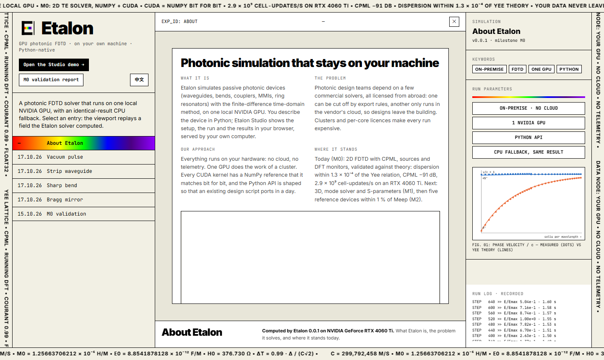
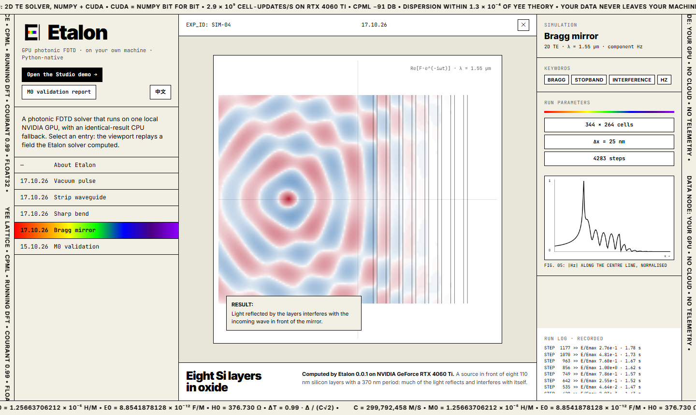
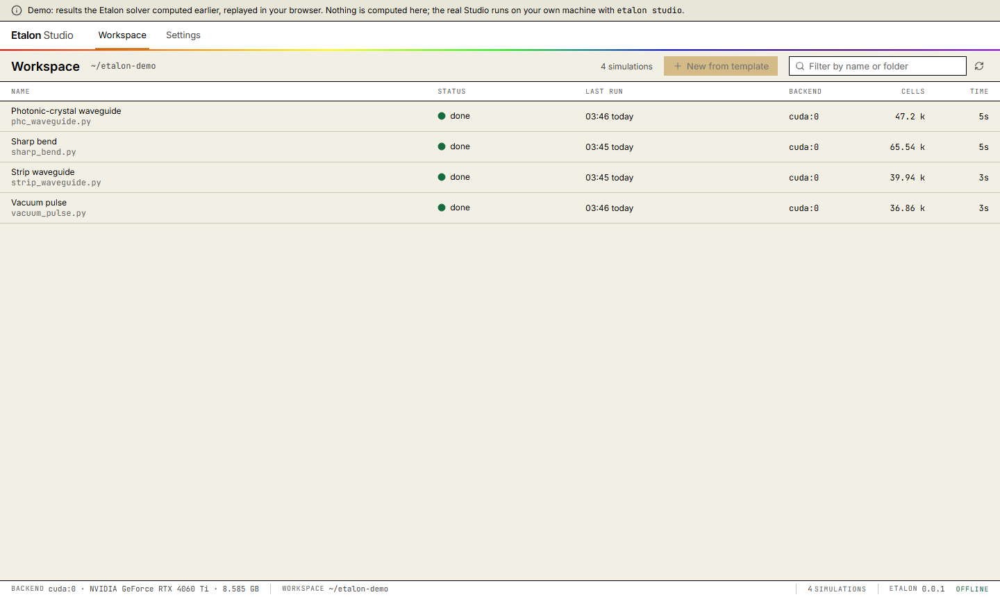
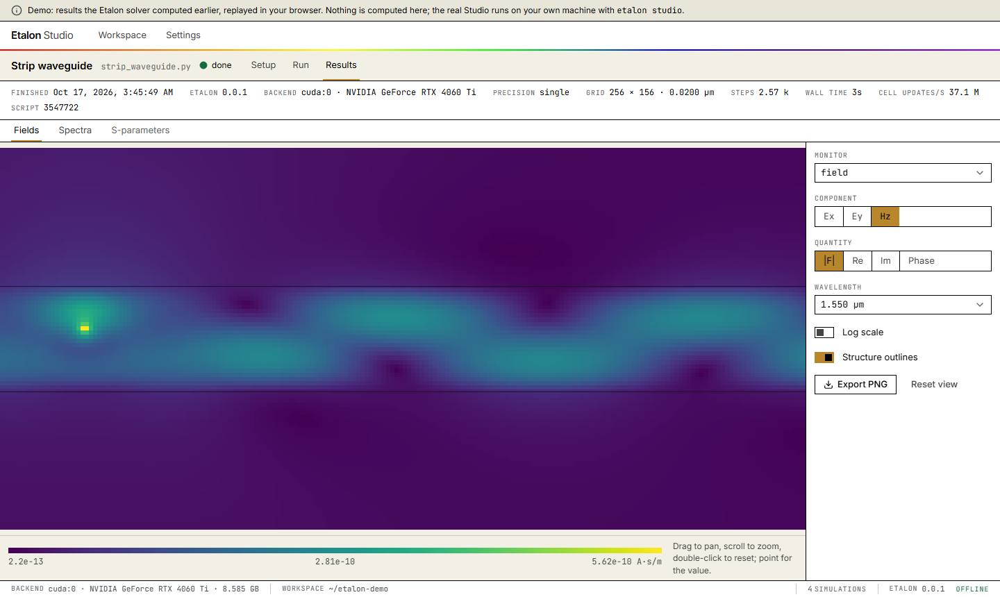

<p align="center">
  
</p>

<h1 align="center">Etalon</h1>

<p align="center">
  <strong>Photonic simulation that stays on your machine.</strong>
</p>

<p align="center">
  
  
  
  
  
  
  
  
  
  
</p>

<p align="center">
  <a href="https://etalon-studio.netlify.app"></a>
  
  
</p>

Etalon simulates passive photonic devices — waveguides, bends, couplers, MMIs, ring resonators — with the finite-difference time-domain (FDTD) method, on **one local NVIDIA GPU**. You describe the device in Python; **Etalon Studio** shows the setup, the run and the results in your browser, served by your own computer. A NumPy reference backend gives the same result, bit for bit, on any machine without a GPU.

There is no cloud and no telemetry: your design data never leaves your machine. The Python API is shaped so that an existing design script ports in a day, and correctness is the product: every CUDA kernel has a NumPy reference it must match, and every physics feature ships with a validation against theory.

The name is a Fabry–Pérot *etalon*; *étalon* is French for "standard". The logo draws one: the E's spine and the thin line beside it are the two mirrors, and its arms are the standing waves between them.

## Live demo

**[etalon-studio.netlify.app](https://etalon-studio.netlify.app)**: the landing page replays fields the solver computed, and [`/studio/`](https://etalon-studio.netlify.app/studio/) is Etalon Studio running on recorded GPU runs. Nothing is computed in the browser.

<p align="center">
  
  
</p>
<p align="center">
  
  
</p>

## What works today

**Solver, milestone M0:** 2D TE FDTD (Ex, Ey, Hz) with CPML, point sources, DFT monitors, a NumPy reference backend and a CUDA backend, measured with [`bench/validate_m0.py`](bench/validate_m0.py) ([report](bench/results/m0_vacuum.png)):

| Criterion | Required | Measured |
| --- | --- | --- |
| Phase velocity vs the Yee dispersion relation, 0° and 45° | < 0.5 % | ≤ 1.3 × 10⁻⁴ at 9–18 cells/λ, ≤ 3.5 × 10⁻⁵ at 18–36, ≤ 1.1 × 10⁻⁵ at 36–72 |
| CUDA vs NumPy | rtol 10⁻⁵ | bit-for-bit identical, float32 and float64 |
| Throughput, 2000 × 2000 grid | ≥ 2 × 10⁸ cell-updates/s on an RTX 3060-class GPU | 2.9 × 10⁹ on an RTX 4060 Ti (float32), 1.5 × 10⁹ (float64) |

Also checked: CPML reflection −91 dB at 12 layers; no late-time growth over 30 000 steps; the absolute field matches the analytic 2D Green's function within 0.4 % at 26 cells/λ, converging at second order.

**Etalon Studio, U0 + U1:** `etalon studio` opens the local web UI, in English and 简体中文, with a paper-light or dark theme. On the M0 solver it runs end to end:

- **Workspace:** every simulation script by its title, with its last run, plus *New from template* (vacuum pulse, strip waveguide, sharp bend, photonic-crystal waveguide).
- **Setup:** structure tree, a 3D view, the solver's own permittivity slice, the inspector, and the cost estimate with warnings.
- **Run:** progress and the live field over a WebSocket, field energy, the log, cancel.
- **Results:** field maps with hover values and PNG export, point spectra with CSV.

**Benchmark harness:** [`bench/`](bench/) compares Etalon with [Meep](https://meep.readthedocs.io/) on the five reference devices, with Meep's 2D references recorded.

Not yet: 3D, 2D TM, mode solver, S-parameters, subpixel smoothing, nonuniform grids, dispersive media, HDF5 output.

## Example

```python
import numpy as np
import etalon as et

sim = et.Simulation(
    size=(8.0, 8.0, 0.0),  # µm; size_z = 0 -> 2D TE
    grid=et.UniformGrid(dl=0.05),  # µm
    boundary=et.PML(layers=12),  # CPML, outside `size`
    sources=[
        et.PointSource(
            center=(-3, 0, 0),
            component="Hz",
            pulse=et.GaussianPulse(wavelength=1.55, bandwidth=0.5),
        )
    ],
    monitors=[et.DFTMonitor(name="probe", center=(3, 0, 0), wavelengths=np.linspace(1.3, 1.8, 26))],
    run_time=300e-15,  # s
    backend="auto",  # "cuda", "numpy" or "auto"
)
print(sim.summary())  # cells, dt, steps, memory: before running
result = sim.run()
hz = result["probe"]["Hz"]  # complex xarray.DataArray over wavelength
```

The full script is [`examples/00_vacuum_pulse.py`](examples/00_vacuum_pulse.py). Units: lengths in µm, time in s, frequency in Hz; time convention exp(−iωt). The Python package and the command are lowercase: `import etalon`, `etalon studio`.

## Studio

```bash
etalon studio path/to/your/scripts
```

This opens `http://127.0.0.1:8787` and lists every simulation script in the folder by its title, the first line of its docstring. Open one to see its Setup, run it, and read its results; runs happen in a separate process, on the GPU when there is one. Studio listens on 127.0.0.1 only and makes no network requests; fonts and assets are bundled. `--port` picks another port, and `--no-browser` prints the link instead of opening it.

## Architecture

```
etalon/
  core/        Pydantic v2 models: Simulation, Medium, sources, monitors, PML, grid spec
  geometry/    Box (Cylinder, PolySlab and GDS import arrive with M1+)
  grid/        Yee grid, staircase permittivity
  fdtd/        time stepping; CPML; sources; DFT monitors
    backends/  numpy_backend.py (reference) · cupy_backend.py · cuda/*.cu (RawKernels)
  analysis/    numerical dispersion, measured phase velocity
  validation/  M0 cases against theory, throughput
  io/          results as xarray
  studio/      FastAPI server, job runner, script titles, the built SPA
studio/        Studio frontend: React 19 + TypeScript + Vite + Tailwind + three.js + ECharts
site/          landing page (etalon-studio.netlify.app)
bench/         Meep comparison harness: Meep only as a subprocess in its own environment
docs/          specs and milestone plans
examples/      user-facing scripts
tests/         unit · validation · gpu · studio · bench
```

## Install (development)

```bash
uv sync --extra gpu
```

The CUDA backend also needs NVIDIA's CUDA headers and NVRTC, from either a CUDA Toolkit install or NVIDIA's pip wheels. Etalon does not declare these because of their licence (see [`THIRD_PARTY.md`](THIRD_PARTY.md)):

```bash
uv pip install "cupy-cuda12x[ctk]"
```

Without a GPU, everything runs on the NumPy backend and gives the same results.

Studio's frontend needs Node 20+ and pnpm, only to build it:

```bash
pnpm --dir studio install
pnpm --dir studio build
```

`build` writes the bundle to `etalon/studio/static/`, which `etalon studio` serves and the wheel ships. For frontend work, run `etalon studio --no-browser` and `pnpm --dir studio dev`, then open `http://127.0.0.1:5173/?token=<the token it printed>`. After changing an API model, regenerate the frontend types:

```bash
uv run python -m etalon.studio.openapi
pnpm --dir studio gen:api
```

## Checks

```bash
uv run pytest                 # unit, validation, gpu, studio, bench
uv run ruff check . && uv run mypy etalon
pnpm --dir studio check       # types, lint, vitest
pnpm --dir studio e2e         # Playwright against the built SPA
```

- `tests/unit`: fast checks on CPU.
- `tests/validation`: physics against analytic results, CPU, about 40 s.
- `tests/gpu`: CUDA vs NumPy equality and throughput; skipped without CuPy.
- `tests/studio`: the Studio server and command.
- `tests/bench`: the Meep comparison harness, with mocked Meep results; needs neither Meep nor a GPU.

For Playwright, run `pnpm --dir studio build` and, once, `pnpm --dir studio exec playwright install chromium` first.

## Benchmark against Meep

`bench/` compares Etalon with Meep on the five reference devices of [`docs/mvp-spec.md`](docs/mvp-spec.md) §5. The plan, the S-parameter definition and the gates are in [`docs/plan-bench.md`](docs/plan-bench.md). Every shared number (geometry, band, resolution, PML, Courant, run time) is in [`bench/config.yaml`](bench/config.yaml), and both codes read it. [`bench/results/bench_devices.png`](bench/results/bench_devices.png) shows the layouts.

Meep is GPL-2.0-or-later, so it is kept outside Etalon:
- It runs only as a subprocess, in its own conda environment ([`bench/meep/env.yaml`](bench/meep/env.yaml)).
- Only `bench/meep/` imports it, and a test checks that.
- On Windows the environment lives in WSL2, because conda-forge has no Windows build of `pymeep`.

One-time setup inside WSL (Ubuntu 24.04), as root:

```bash
curl -Ls https://micro.mamba.pm/api/micromamba/linux-64/latest | tar -xj -C /usr/local bin/micromamba
micromamba create -y -r /opt/micromamba -n etalon-meep -f bench/meep/env.yaml
```

Run the comparison and write `bench/results/<git-sha>.md`:

```bash
uv run python -m bench.run_meep_comparison --tier 2d
```

Meep results are cached in `bench/meep/out/` and reused while the config and the Meep scripts are unchanged. Until M1, Etalon runs only the `point2d` convention check; the five devices are reported as "needs M1".

## Roadmap

| Milestone | What | Accepted when |
| --- | --- | --- |
| **M0** ✓ | 2D TE FDTD, NumPy + CUDA, CPML, DFT monitors | dispersion within 0.5 % of theory; GPU = CPU; ≥ 2 × 10⁸ cell-updates/s |
| **M1** | 3D, PolySlab + subpixel smoothing, mode solver, S-parameters | strip-waveguide n_eff within 0.5 %; \|S21\| ≥ 0.995 |
| **M2** | five reference devices against Meep | max \|ΔS\| < 1 % on all five |
| **M3** | nonuniform grid, dispersive media, GDS import, HDF5, Touchstone, docs | a new user reaches the ring spectrum from the docs alone |
| **M4** | fused kernels, shared-memory tiling | ≥ 10× faster than Meep on 8 CPU cores |

Open questions for M1 are in [`docs/plan-m1.md`](docs/plan-m1.md).

## Licence

Apache-2.0 ([`LICENSE`](LICENSE)). Third-party licences are listed in [`THIRD_PARTY.md`](THIRD_PARTY.md). Meep is used only as an outside benchmark; no GPL code is copied, vendored or imported.
